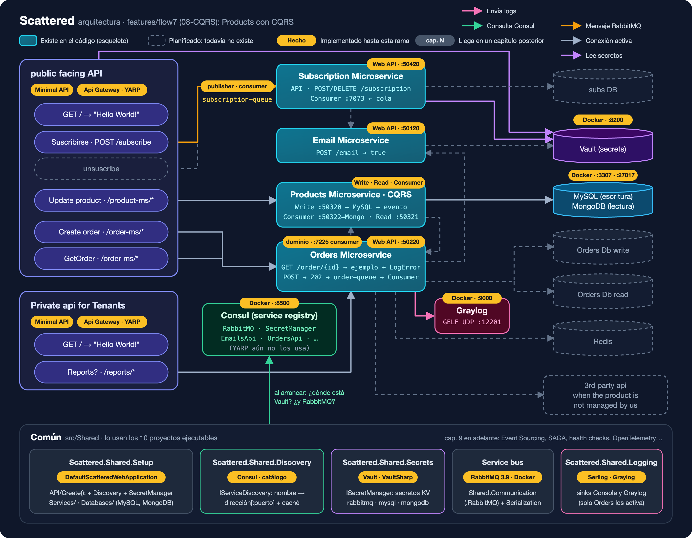

# Scattered


> **Nota:** Scattered es una copia renombrada de [Distribt](https://github.com/ElectNewt/Distribt), proyecto creado por Ivan Abad ([NetMentor](https://www.netmentor.es)) y publicado bajo licencia MIT. El curso y los artículos enlazados en este documento pertenecen al autor original.
>
> **Esta rama (`features/flow7`)** replica la rama [`08-CQRS`](https://github.com/ElectNewt/Distribt/tree/08-CQRS) del proyecto original (commit `53d17af`), renombrada de Distribt a Scattered. Cada capítulo del curso se replica en su propia rama `features/flowN`; la guía de cada uno, con qué cambió y cómo ejecutarlo, está en **[docs/flow/README.md](docs/flow/README.md)**.

## Estado de esta rama

| | |
|---|---|
| Rama | `features/flow7` (nace de `features/flow6`) |
| Capítulo del curso | 8 · [CQRS](https://www.netmentor.es/entrada/patron-cqrs-explicado-10-minutos) para separar lecturas de escrituras |
| Rama original | [`08-CQRS`](https://github.com/ElectNewt/Distribt/tree/08-CQRS) (`53d17af`) |
| Qué hay | 2 API Gateways con YARP; suscripciones (integración) y pedidos (dominio) por RabbitMQ; **Products con CQRS**: escritura en MySQL, lectura en MongoDB y un consumer que sincroniza. Credenciales en Vault, direcciones en Consul, logs en Graylog |
| Qué falta | Event Sourcing (cap. 9), health checks y observabilidad. Un producto **creado** no llega a la lectura (problema heredado) |
| Infraestructura | RabbitMQ, Vault, Consul, Graylog (+2), **MySQL** y **MongoDB** en Docker: `./tools/local-development/up.sh` |
| Guía del capítulo | [docs/flow/flow7.md](docs/flow/flow7.md) |
| Siguiente capítulo | 9 · [Event Sourcing](https://www.netmentor.es/entrada/event-sourcing-explicado-facil) con MongoDB (`09-Event-sourcing`) |

## Qué cambió en este capítulo

Respecto a `features/flow6` ([capítulo 7](docs/flow/flow6.md)) llega **CQRS**: Products separa los **comandos** (crear, actualizar), que van a **MySQL**, de las **consultas**, que leen una vista en **MongoDB**. La vista se mantiene con mensajes de dominio: la escritura publica `ProductUpdated` y un consumer actualiza MongoDB y avisa al resto del sistema con un mensaje de integración.

| Cambio | Dónde | Para qué |
|---|---|---|
| Contenedores `MySql` (`:3307`) y `MongoDb` (`:27017`) con datos iniciales | `docker-compose.yaml`, `tools/mysql/`, `tools/mongodb/` | Modelo de escritura y modelo de lectura |
| `Products` → `Api.Write` (`:50320`), `Api.Read` (`:50321`), `Consumer` (`:50322`), `BusinessLogic`, `Dtos` | `src/Services/Products/` | Comandos, consultas y sincronización en procesos separados |
| `Shared.Databases.MySql` / `.MongoDb` + `Setup/Databases` | `src/Shared/` | Cadenas de conexión construidas con Consul (host:puerto) y Vault (usuario) |
| `products.exchange` → `product-domain-queue` (`internal`) y `product-queue` (`external`) | `tools/rabbitmq/definitions.json` | Dominio para sincronizar la lectura, integración para avisar a otros servicios |
| `AddHandlersInAssembly<T>()` con Scrutor | `ServiceBus.cs` | Los handlers se registran solos y pueden recibir dependencias |
| Test de API con `WebApplicationFactory` + `Create(args, …)` | `src/Tests/`, todos los `Program.cs` | Primer test automático (Subscriptions publica al recibir `POST /subscription`) |
| El gateway usa el secreto KV de RabbitMQ | `ServiceBus.cs` | Vault deja de crear usuarios `token-…` |

```text
Antes (capítulo 7)                         Ahora (capítulo 8)
Products :50320                            Products.Api.Write :50320 ──▶ MySQL ──ProductUpdated──▶ product-domain-queue
  GET  /product/{id} → "TODO"                                                                        │
  POST /product      → true                Products.Consumer :50322 ◀───────────────────────────────┘
                                             ├─▶ MongoDB (vista de lectura)
                                             └─▶ product-queue (integración, sin consumidor aún)
                                           Products.Api.Read  :50321 ──▶ MongoDB   GET /product/{id}
```

Lo que conviene saber al probarlo: actualizar un producto que ya está en MongoDB funciona de punta a punta, pero **un producto nuevo nunca llega a la lectura** (no hay handler de `ProductCreated` y el de `ProductUpdated` falla si el documento no existe, dejando el mensaje atascado); el gateway sigue enviando `/product-ms/*` a la escritura, así que por él se crea pero no se lee. Cambios propios: `MongoDB.Driver` sube a 2.19.0 por una vulnerabilidad y la referencia a `DependencyInjection.Abstractions` pasa a paquete, porque el original apunta a una DLL de Windows. El test de API no pasa con el runtime de .NET 10. Detalle de cada cambio y el flujo end to end de 13 pasos en **[docs/flow/flow7.md](docs/flow/flow7.md)**.

## ¿Qué es Scattered?

Scattered es un proyecto Open Source creado para mostrar el funcionamiento y uso de los sistemas distribuidos con las implementaciones en .NET Core.

La aplicación va a ser "vendor free" lo que quiere decir que no va a estar enlazada directamente a ningún proveedor específico. Obviamente vamos a utilizar X o Y servicio (ya que no vamos a reinventar la rueda), pero lo haremos a través de abstracciones.

Es importante saber estos conceptos ya que cada día las empresas están migrando sus aplicaciones monolíticas a microservicios o incluso serverless, y para poder aplicar un correcto funcionamiento, debemos aprender sobre sistemas distribuidos.

## ¿Qué vamos a ver?

Vamos a ver un sistema distribuido con múltiples características, como pueden ser patrón consumer/publisher, sagas, service discovery, Eventual consistency, etc.

Esta es la arquitectura planteada en el capítulo 1, marcada con lo que ya existe en esta rama (`features/flow7`):



- Las cajas con borde continuo existen en el código; las de borde discontinuo son el objetivo y todavía no existen.
- Las flechas continuas son conexiones que ya funcionan: grises para HTTP (rutas de los gateways), ámbar para mensajes por RabbitMQ, violetas para la lectura de secretos en Vault, verdes para las consultas a Consul y rosas para el envío de logs a Graylog. Las discontinuas son conexiones planificadas.
- Las etiquetas amarillas representan el código ya implementado; las grises indican en qué capítulo llega cada pieza.
- La fuente editable del diagrama es [`assets/architecture.svg`](assets/architecture.svg).

Puedes encontrar el proceso de creación del sistema en [el curso de YouTube del autor original](https://www.youtube.com/playlist?list=PLesmOrW3mp4jpSbdFMtVWINJZ7OLdSASS).

Alternativamente, si lo prefieres, puedes seguir los post con el código detallado y los razonamientos sobre por qué se ha elegido cada tecnología en la web del autor original, [NetMentor - Curso Distribt](https://www.netmentor.es/curso/sistemas-distribuidos).

## Progreso del curso

<!-- progress:start (generado por tools/docs/progress.py desde docs/flow/chapters.json; no editar a mano) -->
Cada capítulo se replica en su propia rama `features/flowN` y tiene su guía en `docs/flow`. **8 de 17 capítulos** replicados.

- [x] 1 · [API Rest](https://www.netmentor.es/entrada/api-rest-csharp): esqueleto de microservicios creados con .NET · [guía](docs/flow/flow1.md)
- [x] 2 · [Patrón API Gateway](https://www.netmentor.es/entrada/patron-api-gateway) con YARP · [guía](docs/flow/flow2.md)
- [x] 3–4 · [Producers/Consumers](https://www.netmentor.es/entrada/patron-productor-consumidor) para la comunicación asíncrona [con RabbitMQ](https://www.netmentor.es/entrada/rabbitmq-comunicacion-asincrona) · [guía](docs/flow/flow3.md)
- [x] 5 · [Gestión de credenciales](https://www.netmentor.es/entrada/gestion-credenciales-vault) con Vault · [guía](docs/flow/flow4.md)
- [x] 6 · [Service discovery / registry](https://www.netmentor.es/entrada/service-registry-discovery-consul) con Consul · [guía](docs/flow/flow5.md)
- [x] 7 · [Sistema de logs](https://www.netmentor.es/entrada/servicio-logs-graylog) con Graylog y Serilog · [guía](docs/flow/flow6.md)
- [x] 8 · [CQRS](https://www.netmentor.es/entrada/patron-cqrs-explicado-10-minutos) para separar lecturas de escrituras · [guía](docs/flow/flow7.md) **← esta rama**
- [ ] 9 · [Event Sourcing](https://www.netmentor.es/entrada/event-sourcing-explicado-facil) con MongoDB
- [ ] 10 · [Consistencia eventual](https://www.netmentor.es/entrada/consistencia-eventual-microservicios) entre microservicios
- [ ] 11 · [Unificación de respuestas de API](https://www.netmentor.es/entrada/unificar-respuestas-api) con [ROP](https://www.netmentor.es/entrada/railway-oriented-programming)
- [ ] 12 · [Patrón SAGA](https://www.netmentor.es/entrada/patron-saga) para transacciones distribuidas
- [ ] 13 · [Health checks](https://www.netmentor.es/entrada/health-checks-asp-net)
- [ ] 14 · [Observabilidad](https://www.netmentor.es/entrada/monitorizacion-sistemas-distribuidos) con OpenTelemetry, Prometheus, Grafana y Zipkin
- [ ] 15 · [API Key](https://www.netmentor.es/entrada/explicacion-api-key) para las llamadas desde clientes
- [ ] 16 · [Rate Limiting](https://www.netmentor.es/entrada/rate-limiting)
- [ ] 17 · [.NET Aspire](https://www.netmentor.es/entrada/introduccion-net-aspire) (rama aparte en el original)
<!-- progress:end -->

## Descripción del repositorio

Todo el contenido se encuentra en este mismo repositorio para facilitar ver cómo funcionan las diferentes piezas.

Nota: técnicamente cada carpeta representa un dominio y podría ser su propio repositorio independiente, pero para facilitar el desarrollo y el seguimiento de los vídeos y posts está todo en un único repo.

```text
Scattered/
├── src/
│   ├── Api/
│   │   ├── Public/Scattered.API.Public       Gateway YARP :7283  /order-ms/* · /product-ms/* + POST /subscribe (publica)
│   │   └── Private/Scattered.API.Private     Gateway YARP :7022  /reports/*
│   ├── Services/
│   │   ├── Emails/Scattered.Services.Emails                :50120  POST /email
│   │   ├── Orders/
│   │   │   ├── Scattered.Services.Orders                   :50220  GET /order/{id} · POST /order (202, publica dominio) · logs a Graylog
│   │   │   ├── Scattered.Services.Orders.Consumer          :7225   consume order-queue
│   │   │   └── Scattered.Services.Orders.Dto                       OrderDto · CreateOrderDto · OrderAddress · PersonalDetails
│   │   ├── Products/
│   │   │   ├── Scattered.Services.Products.Api.Write       :50320  POST /product (201) · PUT /product/updateproductdetails/{id} → MySQL
│   │   │   ├── Scattered.Services.Products.Api.Read        :50321  GET /product/{id} → MongoDB
│   │   │   ├── Scattered.Services.Products.Consumer        :50322  product-domain-queue → MongoDB + product-queue
│   │   │   ├── Scattered.Services.Products.BusinessLogic           casos de uso, ProductsWriteStore (EF Core), ProductsReadStore (Mongo)
│   │   │   └── Scattered.Services.Products.Dtos                    CreateProductRequest · ProductDetails · FullProductResponse · eventos
│   │   └── Subscriptions/
│   │       ├── Scattered.Services.Subscriptions            :50420  POST · DELETE /subscription
│   │       ├── Scattered.Services.Subscriptions.Consumer   :7073   consume subscription-queue
│   │       └── Scattered.Services.Subscriptions.Dtos               SubscriptionDto · UnSubscriptionDto
│   └── Shared/
│       ├── Scattered.Shared.Setup           API/ (arranque común) + Services/ (ServiceBus, SecretManager, ServiceDiscovery) + Databases/ (MySql, MongoDb) + GlobalUsings.cs
│       ├── Scattered.Shared.Discovery       IServiceDiscovery / ConsulServiceDiscovery (paquete Consul)
│       ├── Scattered.Shared.Logging         ConfigureSerilog(): sinks de consola y Graylog según configuración
│       ├── Scattered.Shared.Secrets         ISecretManager / VaultSecretManager (VaultSharp)
│       ├── Scattered.Shared.Serialization   ISerializer (Newtonsoft / System.Text.Json)
│       ├── Scattered.Shared.Api             Sin código: solo el .csproj (ASP.NET Core + Swashbuckle) que referencia Setup
│       ├── Shared.Databases/                MySql (EF Core) · MongoDb (IMongoDbConnectionProvider)
│       └── Shared.Communication/
│           ├── Scattered.Shared.Communication            Mensajes, publisher, consumer y handlers (sin broker)
│           └── Scattered.Shared.Communication.RabbitMQ   Implementación con RabbitMQ.Client
│   └── Tests/Services/Subscriptions/…ApiTests   Test de API con WebApplicationFactory
├── tools/
│   ├── rabbitmq/             rabbitmq.config + definitions.json (usuario y topología: suscripciones y pedidos)
│   ├── vault/config.sh       Secretos KV (rabbitmq, mysql, mongodb), motor rabbitmq y rol scattered-role
│   ├── consul/config.sh      Registro de RabbitMQ, SecretManager, MySql, MongoDb y los microservicios
│   ├── mysql/init.sql        Tabla Products + 3 productos (escritura)
│   ├── mongodb/mongo-init.js Colección Products + 3 productos (lectura)
│   └── local-development/    up.sh: docker-compose up + los dos config.sh
├── docs/
│   ├── flow/                 Guía del flujo paso a paso, un archivo por capítulo
│   └── communication/        Documentación de Shared.Communication
├── assets/                   Imágenes de este README
├── docker-compose.yaml       RabbitMQ 3.9 (:5672, UI :15672) + Vault (:8200) + Consul (:8500) + Graylog (:9000) + MySQL (:3307) + MongoDB (:27017)
└── Scattered.sln             Solución (.NET 6)
```

* **Api**: los API Gateways. Reenvían peticiones HTTP con YARP y, en el caso del público, también **publican mensajes** (`POST /subscribe`).
* **Services**: los microservicios. Subscriptions y Orders se dividen en API, *consumer* y DTOs: el consumer es un proceso aparte que solo lee de la cola (de integración en Subscriptions, de dominio en Orders). Products aplica CQRS: una API para escribir, otra para leer y un consumer que sincroniza las dos bases de datos.
* **Shared**: código común. Los secretos y el registro de servicios también pasan por abstracciones, `ISecretManager` e `IServiceDiscovery`; solo `Shared.Secrets` sabe que detrás está Vault y solo `Shared.Discovery` que detrás está Consul. La comunicación asíncrona sigue la idea *vendor free*: los servicios solo usan `IIntegrationMessagePublisher` y `IIntegrationMessageHandler<T>`; que detrás esté RabbitMQ solo lo sabe `Shared.Communication.RabbitMQ`. Así queda el consumer:

```csharp
WebApplication app = DefaultScatteredWebApplication.Create(args, x =>
{
    x.Services.AddScoped<IDependenciaTest, DependenciaTest>();
    x.Services.AddHandlersInAssembly<SubscriptionHandler>();
    x.Services.AddServiceBusIntegrationConsumer(x.Configuration);
});

DefaultScatteredWebApplication.Run(app);
```

## Documentación

* Flujo paso a paso por capítulo - [docs/flow](docs/flow/README.md)
* Shared.Communication - [docs/communication/Readme.md](docs/communication/Readme.md)

## ¿Cómo ejecutar la aplicación?

Hace falta [Docker](https://www.netmentor.es/curso/docker) para RabbitMQ, Vault, Consul, Graylog, MySQL y MongoDB. `up.sh` levanta los contenedores, carga los secretos en Vault (RabbitMQ, MySQL y MongoDB) y registra los servicios en Consul:

```bash
./tools/local-development/up.sh
dotnet build Scattered.sln
P=src/Services/Products
DOTNET_ROLL_FORWARD=Major dotnet run --project $P/Scattered.Services.Products.Api.Write/Scattered.Services.Products.Api.Write.csproj
DOTNET_ROLL_FORWARD=Major dotnet run --project $P/Scattered.Services.Products.Api.Read
DOTNET_ROLL_FORWARD=Major dotnet run --project $P/Scattered.Services.Products.Consumer
curl -k https://localhost:50321/product/2                                        # leer (MongoDB)
curl -k -X PUT https://localhost:50320/product/updateproductdetails/2 -H 'Content-Type: application/json' \
  -d '{"name":"Segundo producto (editado)","description":"Actualizado por CQRS"}'  # escribir (MySQL)
curl -k https://localhost:50321/product/2                                        # la lectura ya refleja el cambio
```

Usa un producto de la semilla (1, 2 o 3) para ver la sincronización: los creados con `POST /product` no llegan a MongoDB (problema heredado). Si RabbitMQ ya estaba corriendo, reinícialo (`docker restart rabbitmq`) para que cree `products.exchange`. Graylog necesita el input *GELF UDP* creado una vez ([capítulo 7](docs/flow/flow6.md#cómo-ejecutarla)). Las UIs: Consul (:8500), Vault (:8200, token `vault-scattered-token`), RabbitMQ (:15672, `ScatteredAdmin` / `ScatteredPass`) y Graylog (:9000, `admin` / `admin`). La lista completa de comandos, el flujo end to end y los problemas conocidos están en [docs/flow/flow7.md](docs/flow/flow7.md#cómo-ejecutarla).

## Cómo evoluciona este README

Al replicar un capítulo nuevo en su rama `features/flowN`, actualiza:

1. La nota inicial, la tabla **Estado de esta rama** y la sección **Qué cambió en este capítulo** (se reescribe en cada capítulo; la de los anteriores queda en su guía de `docs/flow`).
2. El **diagrama**: edita `assets/architecture.svg` (pasa a borde continuo y etiqueta amarilla lo que ya existe) y regenera `assets/diagram.png`:
   ```bash
   "/Applications/Google Chrome.app/Contents/MacOS/Google Chrome" --headless=new \
     --hide-scrollbars --force-device-scale-factor=2 --window-size=1400,1090 \
     --screenshot=assets/diagram.png "file://$PWD/assets/architecture.svg"
   ```
3. **Progreso del curso** no se edita a mano: lo genera `tools/docs/progress.py` desde `docs/flow/chapters.json`, y los hooks de `.githooks/` lo ejecutan en cada commit y merge (actívalos una vez con `git config core.hooksPath .githooks`; ver [docs/flow](docs/flow/README.md#4-documentar-y-cerrar-el-capítulo)).
4. El árbol de **Descripción del repositorio** y **¿Cómo ejecutar la aplicación?** (a partir del capítulo 3 hace falta `docker-compose`).
5. Crea `docs/flow/flowN.md` con el detalle del capítulo y enlázalo desde [docs/flow/README.md](docs/flow/README.md).

## Dale una estrella ⭐
Si te gusta el proyecto no dudes en darle una estrella al [proyecto original](https://github.com/ElectNewt/Distribt), hacer un fork junto a una PR o incluso apoyar económicamente al autor [donando un café](https://www.buymeacoffee.com/netmentor).
