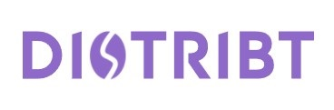
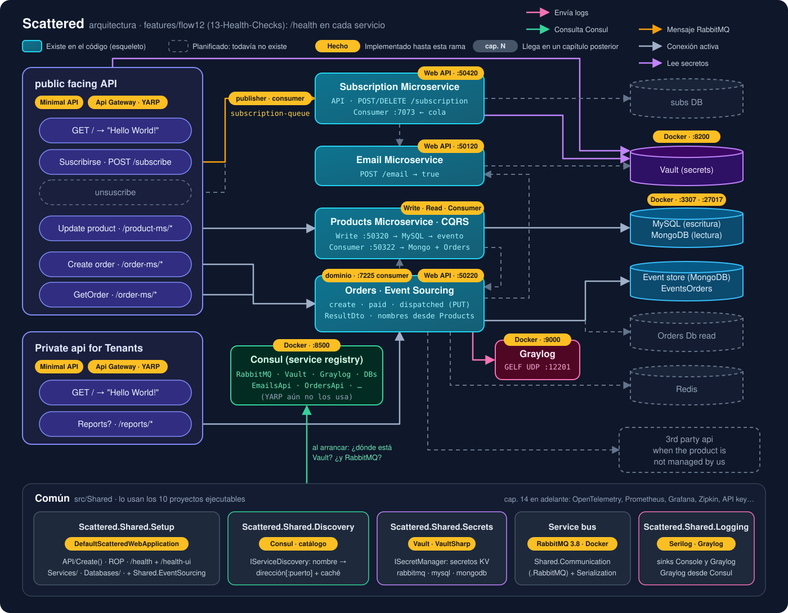

# Scattered



> **Nota:** Scattered es una copia renombrada de [Distribt](https://github.com/ElectNewt/Distribt), proyecto creado por Ivan Abad ([NetMentor](https://www.netmentor.es)) y publicado bajo licencia MIT. El curso y los artículos enlazados en este documento pertenecen al autor original.
>
> **Propósito de esta copia:** este repositorio existe con fines de aprendizaje. Su objetivo es replicar paso a paso el flujo del curso e ir agregando particularidades personales derivadas de ese aprendizaje, por lo que el código puede diferir del proyecto original.

## ¿Qué es Scattered? 

Scattered es un proyecto Open Source creado para mostrar el funcionamiento y uso de los sistemas distribuidos con las implementaciones en .NET Core.


La aplicación va a ser "vendor free" lo que quiere decir que no va a estar enlazada directamente a ningún proveedor específico. Obviamente vamos a utilizar X o Y servicio (ya que no vamos a reinventar la rueda), pero lo haremos a través de abstracciones.  


Es importante saber estos conceptos ya que cada día las empresas están migrando sus aplicaciones monolíticas a microservicios o incluso serverless, y para poder aplicar un correcto funcionamiento, debemos aprender sobre sistemas distribuidos. 

## ¿Qué vamos a ver? 
Vamos a ver un sistema distribuido con múltiples características, como pueden ser patrón consumer/publiser, sagas, service discovery, Eventual consistency, etc.

La arquitectura que vamos a ver es la siguiente:


- Nota: las etiquetas amarillas representan el código ya implementado.

Puedes encontrar el proceso de creación del sistema en [el curso de YouTube del autor original](https://www.youtube.com/playlist?list=PLesmOrW3mp4jpSbdFMtVWINJZ7OLdSASS).

Alternativamente, si lo prefieres, puedes seguir los post con el código detallado y los razonamientos sobre por qué se ha elegido cada tecnología en la web del autor original, [NetMentor - Curso Distribt](https://www.netmentor.es/curso/sistemas-distribuidos)

Si estás siguiendo el curso vídeo a vídeo tienes diferentes branches en el repositorio original con el código de cada vídeo (de forma incremental) aquí:  https://github.com/ElectNewt/Distribt/branches/all 

## Infraestructura
Hasta ahora hemos visto las siguientes funcionalidades:


* [API Rest](https://www.netmentor.es/entrada/api-rest-csharp) microservicios creados con .NET
* [Patrón API Gateway](https://www.netmentor.es/entrada/patron-api-gateway) con YARP.
* [Producers/Consumers](https://www.netmentor.es/entrada/patron-productor-consumidor) para la comunicación asíncrona [implementado con RabbitMQ](https://www.netmentor.es/entrada/rabbitmq-comunicacion-asincrona).
* [Acceso y almacenamiento seuguro](https://www.netmentor.es/entrada/gestion-credenciales-vault) de la informción secreta con Vault.
* [Registro de servicios](https://www.netmentor.es/entrada/service-registry-discovery-consul) con Consul (service discovery / Service registry).
* [Sistema de logs](https://www.netmentor.es/entrada/servicio-logs-graylog) con GrayLog y SeriLog.
* [CQRS](https://www.netmentor.es/entrada/patron-cqrs-explicado-10-minutos) para separar lecturas de escrituras.
* [Event Sourcing](https://www.netmentor.es/entrada/event-sourcing-explicado-facil) junto a MongoDb para almacenar los eventos.
* [Eventual Consistency](https://www.netmentor.es/entrada/consistencia-eventual-microservicios) usando comunicación asíncrona para sincronizar los diferentes microservicios.
* [Unificación de las API](https://www.netmentor.es/entrada/unificar-respuestas-api) para tener una respuesta consistente con [Rop](https://www.netmentor.es/entrada/railway-oriented-programming).
* [Patrón SAGA](https://www.netmentor.es/entrada/patron-saga) para las transacciones distribuidas.
* [Health checks](https://www.netmentor.es/entrada/health-checks-asp-net) Para la visibilidad de la salud de nuestros microservicios.
* [Observabilidad](https://www.netmentor.es/entrada/monitorizacion-sistemas-distribuidos) De nuestro sistema e infraestructura (metricas y traces) con OpenTelemetry, Prometheus, Grafana y Zipkin
* [API Key](https://www.netmentor.es/entrada/explicacion-api-key) Para las llamadas desde clientes.
* [Rate Limiting](https://www.netmentor.es/entrada/rate-limiting) Para limitar el uso de recursos.
* [Aspire](https://www.netmentor.es/entrada/introduccion-net-aspire) Para ejecución local de las applicaiones. nota, está solo en un [branch](https://github.com/ElectNewt/Distribt/tree/17-Aspire-version2023) ya que aspire sigue en preview.


## Documentación [En progreso]
Puedes encontrar documentación de cada projecto dentro de `Shared` en la carpeta `docs`.
* Shared.Communication - [Enlace](docs/communication/Readme.md)
* Shared.Discovery - [Enlace](docs/discovery/Readme.md)
* Shared.Secrets - [Enlace](docs/secrets/Readme.md)


## Descripción del repositorio

Todo el contenido se encuentra en este mismo repositorio esto es así para una mayor facilidad a la hora de ver cómo funcionan las diferentes herramientas.

Puedes encontrar el código dentro de la carpeta `src`. Donde encontrarás múltiples carpetas.

Nota: Técnicamente cada carpeta representa un dominio y puede ser su propio repositorio independiente, pero para una mayor facilidad del desarrollo y del seguimiento en los vídeos y posts está todo en un único repo.

* Api: capa de abstracción de una API Gateway.
* Services: Carpeta que contiene los microservicios del sistema.
* Shared: código común de las abstracciones.


## ¿Cómo ejecutar la aplicación? 

Para ejecutar la aplicación correctamente debes tener [Docker](https://www.netmentor.es/curso/docker) instalado en tu máquina y entender cómo funciona docker-compose.

El repositorio incluye un fichero `docker-compose.yaml` que ya contiene toda la configuración necesaria para que una vez ejecutes la solución, esta funcione sin problemas.

Eventualmente lo veremos toda la configuración en kubernetes (con [project tye](https://github.com/dotnet/tye)).

Para poder ejecutar la aplicación correctamente en local, necestiaras ejecutar tanto el fichero `docker-compose` como la configuración para los diferentes servicios utilizados. 

Para ahorrar tiempo hay un fichero `bash` que ejectua todo `./tools/local-development/up.sh`

Y luego simplemente ejecuta cada aplicacion de forma individual o en un compound para poder testearlas.

En esta copia hay además un segundo fichero que compila la solución y arranca todos los servicios a la vez (necesitas el SDK de .NET 10):

```bash
./tools/local-development/up.sh            # infraestructura
./tools/local-development/run-services.sh  # servicios
```

Los logs de cada servicio quedan en `tools/local-development/logs` y con `Ctrl+C` se detienen todos.

## Cambios respecto al proyecto original

Esta sección documenta todo lo que se modificó en esta copia para que la aplicación compile y levante hoy en local. El proyecto original apuntaba a .NET 8 y a versiones de paquetes e imágenes de la época de .NET 6; varias de ellas ya no existen o cambiaron de comportamiento.

Entorno en el que se verificó: macOS (Apple Silicon, arm64), SDK de .NET 10.0.403 y Docker 29.9.2.

### Resumen por commit

| Commit | Contenido |
|---|---|
| `f894488` | Arreglos de la infraestructura local (Docker, OpenTelemetry Collector, Consul, permisos de scripts) |
| `1391701` | Arreglos de arranque del gateway privado y de la API de Subscriptions |
| `5da9951` | Fase 1: migración de .NET 8 a .NET 10 |
| `f535c42` | Fase 2: eliminación de dependencias con vulnerabilidades conocidas |
| `378faa5` | Fase 3: actualización de paquetes de bajo esfuerzo |
| `b9fbe77` | Script para compilar y arrancar todos los servicios |

### 1. Infraestructura local

| Archivo | Problema | Cambio |
|---|---|---|
| `docker-compose.yaml` | La imagen `bitnami/prometheus` ya no se publica en Docker Hub y abortaba todo el `docker-compose up` | Se usa la imagen oficial `prom/prometheus` |
| `tools/telemetry/otel-collector-config.yaml` | El colector actual eliminó el exportador `logging` y se caía al arrancar | Se sustituye por el exportador `debug` en los tres pipelines |
| `tools/telemetry/otel-collector-config.yaml` | El receptor OTLP ya no escucha por defecto en todas las interfaces | Se fija `endpoint: 0.0.0.0:4317` en el receptor gRPC |
| `tools/consul/config.sh` | La CLI de Consul actual rechaza direcciones con esquema (`http://...`), por lo que fallaban 6 de los 11 registros (Vault y todas las APIs) | Esos servicios se registran por la API HTTP de Consul (`PUT /v1/agent/service/register`) mediante la función `register_with_scheme` |
| `tools/local-development/up.sh`, `tools/vault/config.sh`, `tools/consul/config.sh` | No tenían permiso de ejecución | Se marcan como ejecutables |

### 2. Arreglos de arranque

| Archivo | Problema | Cambio |
|---|---|---|
| `src/Api/Private/Scattered.API.Private/Program.cs` | El gateway privado llamaba a `UseRateLimiter()` sin registrar sus servicios y se caía al iniciar | Se añade `AddRateLimiter` |
| `src/Services/Subscriptions/Scattered.Services.Subscriptions/Properties/launchSettings.json` | Faltaba la variable `VAULT-TOKEN` que sí tienen los demás proyectos; `/health` devolvía 500 | Se añade `VAULT-TOKEN` al perfil de arranque |

### 3. Fase 1: migración a .NET 10

.NET 8 llegó al final de su soporte, así que la solución se migró a .NET 10 (LTS).

- `TargetFramework` pasa de `net8.0` a `net10.0` en `GlobalSettings.msbuild` y en los 20 `.csproj` que lo declaraban.
- Se elimina el `LangVersion` fijado en `12.0` de `GlobalSettings.msbuild`; se usa la versión de C# que trae el SDK.
- `.github/workflows/build&Test.yml` compila con `dotnet-version: 10.0.x`.
- Se eliminan dos proyectos huérfanos que no formaban parte de la solución: `Scattered - Backup.Services.Products.csproj` (net6.0) y `src/Shared/Scattered.Shared.Api` (net7.0). El primero impedía ejecutar `dotnet run --project` sobre la carpeta de `Products.Api.Write`.

No hizo falta cambiar código C# para esta fase.

### 4. Fase 2: dependencias con vulnerabilidades conocidas

Al compilar para .NET 10 el SDK reporta las vulnerabilidades de los paquetes transitivos. Había 16 paquetes afectados (uno crítico); tras esta fase `dotnet list package --vulnerable --include-transitive` no devuelve ninguno.

| Paquete | Antes | Ahora | Motivo |
|---|---|---|---|
| `Microsoft.AspNetCore.Mvc` | 2.2.0 | eliminado | Arrastraba `System.Drawing.Common` (crítica). Se sustituye por `<FrameworkReference Include="Microsoft.AspNetCore.App"/>` en `Scattered.Shared.Communication` |
| `AspNetCore.HealthChecks.UI`, `.UI.Client`, `.UI.InMemory.Storage` | 6.0.4 | 9.0.0 | Arrastraban `KubernetesClient`, `AutoMapper`, SQLite y JWT vulnerables |
| `AspNetCore.HealthChecks.MySql` | 6.0.2 | 9.0.0 | Arrastraba `MySqlConnector` vulnerable |
| `AspNetCore.HealthChecks.MongoDb` | 6.0.2 | 9.0.0 | Requerido por el nuevo driver de MongoDB |
| `MongoDB.Driver` | 2.19.0 | 3.13.0 | Arrastraba `Snappier` y `SharpCompress` vulnerables |
| `Microsoft.EntityFrameworkCore` | 6.0.3 | 10.0.12 | Arrastraba `Microsoft.Extensions.Caching.Memory` vulnerable |
| `MySql.EntityFrameworkCore` | 6.0.0 | 10.0.12 | Debe coincidir con la versión de EF Core |
| `OpenTelemetry.Exporter.Console`, `OpenTelemetry.Exporter.OpenTelemetryProtocol` | 1.3.0 | 1.21.0 | `OpenTelemetry.Api` vulnerable |
| `OpenTelemetry.Extensions.Hosting` | 1.0.0-rc9.4 | 1.21.0 | Ídem |
| `OpenTelemetry.Instrumentation.AspNetCore` | 1.8.1 | 1.21.0 | Ídem |
| `Consul` | 1.6.10.3 | 1.8.0 | Arrastraba `Newtonsoft.Json` 10.0.3 vulnerable |
| `Microsoft.Extensions.*` (Caching.Memory, Configuration.Abstractions, DependencyInjection, DependencyInjection.Abstractions, Hosting.Abstractions, Http, Options.ConfigurationExtensions) | 2.2.0 / 3.1.3 / 6.0.0 | 10.0.12 | Evitar degradaciones de versión (NU1605) con los paquetes anteriores |
| `Microsoft.NET.Test.Sdk` | 16.11.0 / 17.4.0 | 18.12.0 | Arrastraba `Newtonsoft.Json` antiguo |
| `Microsoft.AspNetCore.Mvc.Testing` | 6.0.2 | 10.0.12 | Alineado con .NET 10 |

Paquetes que se fijan explícitamente aunque el código no los usa de forma directa:

| Paquete | Versión | Motivo |
|---|---|---|
| `MySqlConnector` | 2.6.2 | La versión que trae `HealthChecks.MySql` 9.0.0 sigue siendo vulnerable (GHSA-473q-m89c-ghf8) |
| `KubernetesClient` | 17.0.14 | La versión que trae `HealthChecks.UI` 9.0.0 sigue siendo vulnerable (GHSA-w7r3-mgwf-4mqq) |
| `IdentityModel` | 5.2.0 | `HealthChecks.UI` lo necesita y el `KubernetesClient` fijado ya no lo incluye; sin él el recolector de health checks falla |
| `Microsoft.EntityFrameworkCore.InMemory` | 10.0.12 | `HealthChecks.UI.InMemory.Storage` trae el proveedor de EF Core 8, incompatible con EF Core 10; sin él los servicios no arrancan |

Cambios de código que exigieron las nuevas versiones:

| Archivo | Cambio |
|---|---|
| `src/Shared/Scattered.Shared.Setup/Observability/OpenTelemetry.cs` | `AddOpenTelemetryTracing` y `AddOpenTelemetryMetrics` ya no existen; se usa `AddOpenTelemetry().WithTracing(...)` y `.WithMetrics(...)` |
| `src/Shared/Shared.Databases/Scattered.Shared.Databases.MongoDb/MongoDbDependencyInjection.cs` | Nueva firma de `AddMongoDb` en el health check (recibe una factoría de `IMongoClient`) |
| Ídem | Se registra `GuidSerializer(GuidRepresentation.CSharpLegacy)`: el driver 3.x exige indicar la representación de `Guid`, y esta es la que usaba el driver 2.x por defecto |
| Ídem | Se registra un `ObjectSerializer` que permite los tipos `Scattered.*`. Sin él, guardar eventos en el event store fallaba con error 500 al crear un pedido (este fallo ya existía antes de la actualización) |
| `src/Shared/Shared.Communication/Scattered.Shared.Communication.RabbitMQ/RabbitMQDependencyInjection.cs` | Se elimina un `using Microsoft.AspNetCore.JsonPatch.Adapters` sin uso, que dependía del paquete MVC 2.2 |
| `src/Shared/Scattered.Shared.Discovery/ConsulServiceDiscovery.cs`, `DiscoveryDependencyInjection.cs` | Ajustes de nulabilidad por las anotaciones de los paquetes nuevos |
| `src/Tests/Shared/Discovery/.../ConsulServiceDiscoveryTest.cs` | `Consul` 1.8.0 añade una sobrecarga de `Catalog.Service`; los mocks usan `default(CancellationToken)` para evitar la ambigüedad |

### 5. Fase 3: actualización de paquetes de bajo esfuerzo

| Paquete | Antes | Ahora |
|---|---|---|
| `Yarp.ReverseProxy` | 1.1.2 | 2.3.0 |
| `Serilog` | 2.10.0 | 4.4.0 |
| `Serilog.AspNetCore` | 5.0.0 | 10.0.0 |
| `Serilog.Sinks.Console` | 4.0.1 | 6.1.1 |
| `Serilog.Sinks.Graylog` | 2.3.0 | 3.1.1 |
| `Swashbuckle.AspNetCore` | 6.4.0 | 10.3.1 |
| `VaultSharp` | 1.7.0.4 | 1.17.5.1 |
| `Scrutor` | 4.1.0 | 7.0.0 |
| `Newtonsoft.Json` | 13.0.1 | 13.0.4 |
| `xunit` | 2.4.1 / 2.4.2 | 2.9.3 |
| `xunit.runner.visualstudio` | 2.4.3 / 2.4.5 | 4.0.1 |
| `Moq` | 4.17.2 / 4.18.2 | 4.21.0 |
| `coverlet.collector` | 3.1.0 | 10.1.0 |

Cambios de código asociados:

| Archivo | Cambio |
|---|---|
| `src/Shared/Scattered.Shared.Secrets/Extensions/ObjectExtensions.cs` | `VaultSharp` devuelve ahora los valores de los secretos como `JsonElement`; se convierten al tipo de la propiedad. Sin este cambio 6 de los 10 servicios no arrancaban |
| `src/Shared/Scattered.Shared.Logging/Loggers/LoggerConfigurationExtensions.cs` | Cambió la firma de `WriteTo.Graylog`; el nivel mínimo se pasa como argumento con nombre (`minimumLogEventLevel`) |
| `src/Tests/Shared/Discovery/.../ConsulServiceDiscoveryTest.cs` | El analizador de xunit detectó un `Assert.ThrowsAsync` sin `await`; el test pasa a ser `async Task` |

### 6. Script de arranque

Se añade `tools/local-development/run-services.sh`, que compila la solución y arranca los 10 servicios (ver [¿Cómo ejecutar la aplicación?](#cómo-ejecutar-la-aplicación)).

### Requisito adicional: certificado HTTPS de desarrollo

Los servicios se llaman entre sí por HTTPS. Si el certificado de desarrollo de .NET no es de confianza, Orders aparece `Unhealthy`, `GET /order/{id}` falla y los gateways devuelven 502. Se resuelve una sola vez con:

```bash
dotnet dev-certs https --trust
```

### Estado verificado

Con los cambios anteriores:

- La solución compila con 0 errores y 0 advertencias, y los tests pasan (8 correctos, 1 omitido).
- Los 12 contenedores y los 10 servicios levantan y responden `Healthy` en `/health`.
- Se probaron contra los servicios: crear y leer un producto, crear y consultar un pedido, crear una suscripción, el reenvío del gateway público, y la API Key y el rate limiting del gateway privado.

### Pendiente y limitaciones conocidas

- `GET /order/getorderstatus/{id}` no está implementado en el código original (lanza `NotImplementedException`).
- Graylog no trae ninguna entrada configurada: para recibir logs hay que crear una de tipo GELF UDP en el puerto 12201 desde `http://localhost:9000`. El envío de logs con el sink actualizado no se ha verificado.
- La imagen `graylog/graylog:4.2.5` es solo amd64; en Apple Silicon corre emulada.
- El colector de OpenTelemetry avisa de que un componente de la configuración saldrá de su imagen en la versión 0.167; como `docker-compose.yaml` usa `latest`, puede requerir un ajuste futuro.
- `RabbitMQ.Client` sigue en 6.2.2 y `AspNetCore.HealthChecks.Rabbitmq` en 6.0.2: la versión 7 del cliente tiene una API totalmente asíncrona y exige reescribir el publicador y los consumidores.
- `Netmentor.ROP.ApiExtensions` sigue en 1.0.10.
- `IdentityModel` 5.2.0 está marcado como obsoleto en NuGet; es necesario mientras se use `HealthChecks.UI` 9.

## Dale una estrella ⭐
Si te gusta el proyecto no dudes en darle una estrella, hacer un fork junto a una PR o incluso apoyar económicamente al autor original [donando un café](https://www.buymeacoffee.com/netmentor).
