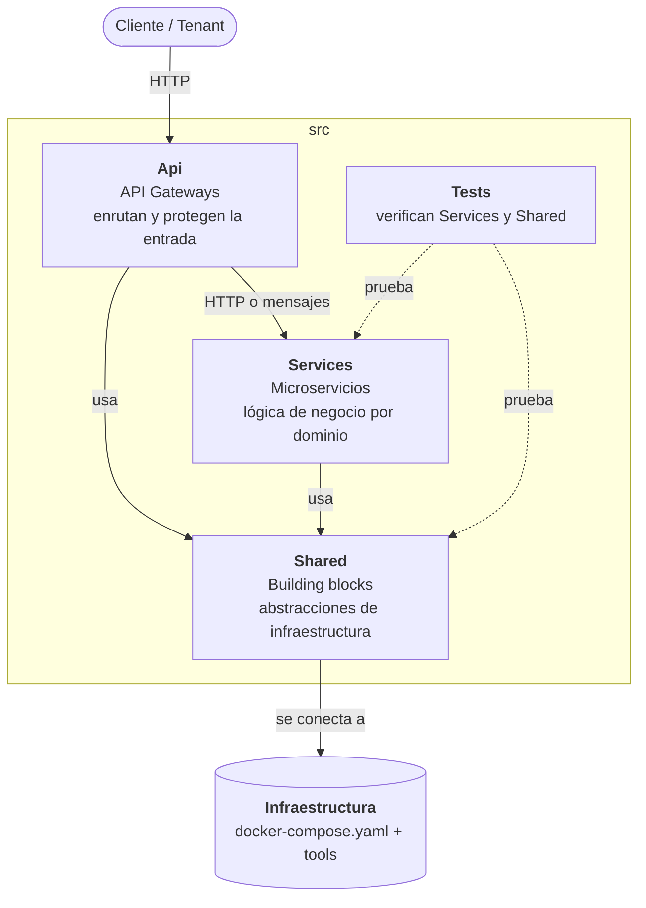
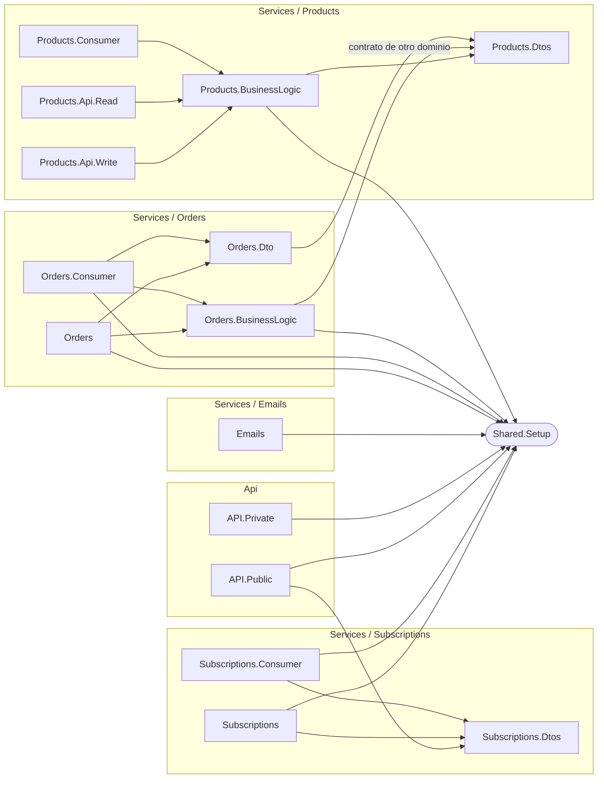
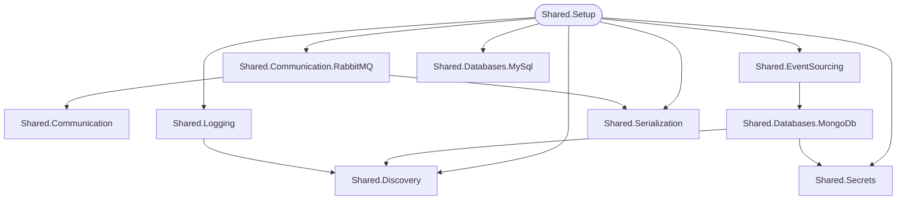
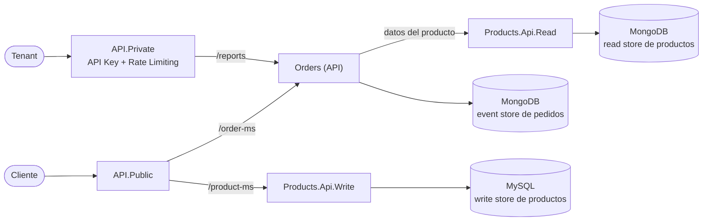
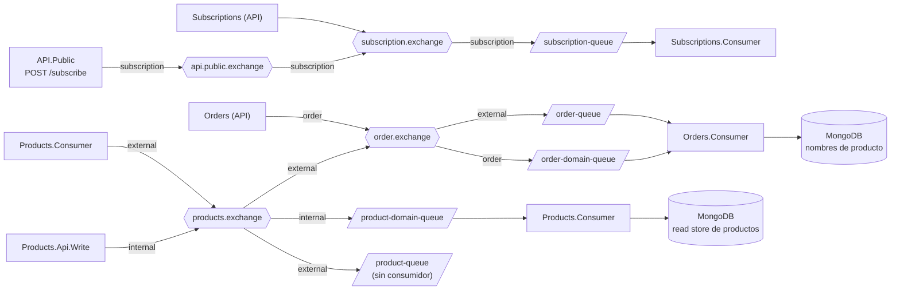
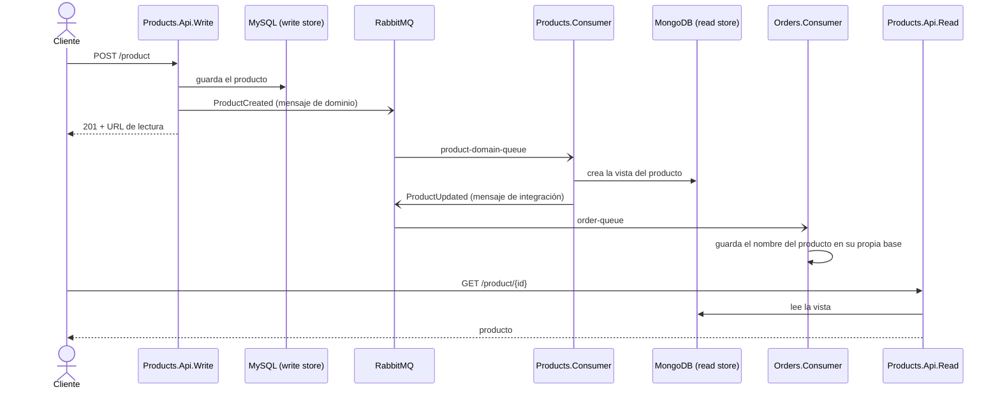
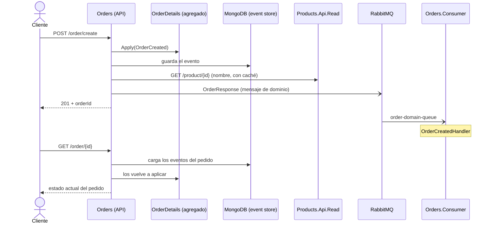

# Scattered


> **Nota:** Scattered es una copia renombrada de [Distribt](https://github.com/ElectNewt/Distribt), proyecto creado por Ivan Abad ([NetMentor](https://www.netmentor.es)) y publicado bajo licencia MIT. El curso y los artículos enlazados en este documento pertenecen al autor original.
>
> **Propósito de esta copia:** este repositorio existe con fines de aprendizaje. Su objetivo es replicar paso a paso el flujo del curso e ir agregando particularidades personales derivadas de ese aprendizaje, por lo que el código puede diferir del proyecto original.

## ¿Qué es Scattered? 

Scattered es un proyecto Open Source creado para mostrar el funcionamiento y uso de los sistemas distribuidos con las implementaciones en .NET Core.


La aplicación va a ser "vendor free" lo que quiere decir que no va a estar enlazada directamente a ningún proveedor específico. Obviamente vamos a utilizar X o Y servicio (ya que no vamos a reinventar la rueda), pero lo haremos a través de abstracciones.  


Es importante saber estos conceptos ya que cada día las empresas están migrando sus aplicaciones monolíticas a microservicios o incluso serverless, y para poder aplicar un correcto funcionamiento, debemos aprender sobre sistemas distribuidos. 

## ¿Qué vamos a ver? 
Vamos a ver un sistema distribuido con múltiples características, como pueden ser patrón consumer/publiser, sagas, service discovery, Eventual consistency, etc.

La arquitectura que vamos a ver es la siguiente:


- Nota: las etiquetas amarillas representan el código ya implementado.

Puedes encontrar el proceso de creación del sistema en [el curso de YouTube del autor original](https://www.youtube.com/playlist?list=PLesmOrW3mp4jpSbdFMtVWINJZ7OLdSASS).

Alternativamente, si lo prefieres, puedes seguir los post con el código detallado y los razonamientos sobre por qué se ha elegido cada tecnología en la web del autor original, [NetMentor - Curso Distribt](https://www.netmentor.es/curso/sistemas-distribuidos)

Si estás siguiendo el curso vídeo a vídeo tienes diferentes branches en el repositorio original con el código de cada vídeo (de forma incremental) aquí:  https://github.com/ElectNewt/Distribt/branches/all 

## Infraestructura
Hasta ahora hemos visto las siguientes funcionalidades:


* [API Rest](https://www.netmentor.es/entrada/api-rest-csharp) microservicios creados con .NET
* [Patrón API Gateway](https://www.netmentor.es/entrada/patron-api-gateway) con YARP.
* [Producers/Consumers](https://www.netmentor.es/entrada/patron-productor-consumidor) para la comunicación asíncrona [implementado con RabbitMQ](https://www.netmentor.es/entrada/rabbitmq-comunicacion-asincrona).
* [Acceso y almacenamiento seuguro](https://www.netmentor.es/entrada/gestion-credenciales-vault) de la informción secreta con Vault.
* [Registro de servicios](https://www.netmentor.es/entrada/service-registry-discovery-consul) con Consul (service discovery / Service registry).
* [Sistema de logs](https://www.netmentor.es/entrada/servicio-logs-graylog) con GrayLog y SeriLog.
* [CQRS](https://www.netmentor.es/entrada/patron-cqrs-explicado-10-minutos) para separar lecturas de escrituras.
* [Event Sourcing](https://www.netmentor.es/entrada/event-sourcing-explicado-facil) junto a MongoDb para almacenar los eventos.
* [Eventual Consistency](https://www.netmentor.es/entrada/consistencia-eventual-microservicios) usando comunicación asíncrona para sincronizar los diferentes microservicios.
* [Unificación de las API](https://www.netmentor.es/entrada/unificar-respuestas-api) para tener una respuesta consistente con [Rop](https://www.netmentor.es/entrada/railway-oriented-programming).
* [Patrón SAGA](https://www.netmentor.es/entrada/patron-saga) para las transacciones distribuidas.
* [Health checks](https://www.netmentor.es/entrada/health-checks-asp-net) Para la visibilidad de la salud de nuestros microservicios.
* [Observabilidad](https://www.netmentor.es/entrada/monitorizacion-sistemas-distribuidos) De nuestro sistema e infraestructura (metricas y traces) con OpenTelemetry, Prometheus, Grafana y Zipkin
* [API Key](https://www.netmentor.es/entrada/explicacion-api-key) Para las llamadas desde clientes.
* [Rate Limiting](https://www.netmentor.es/entrada/rate-limiting) Para limitar el uso de recursos.
* [Aspire](https://www.netmentor.es/entrada/introduccion-net-aspire) Para ejecución local de las applicaiones. nota, está solo en un [branch](https://github.com/ElectNewt/Distribt/tree/17-Aspire-version2023) ya que aspire sigue en preview.


## Documentación [En progreso]
Puedes encontrar documentación de cada projecto dentro de `Shared` en la carpeta `docs`.
* Shared.Communication - [Enlace](docs/communication/Readme.md)
* Shared.Discovery - [Enlace](docs/discovery/Readme.md)
* Shared.Secrets - [Enlace](docs/secrets/Readme.md)


## Descripción del repositorio

Todo el contenido se encuentra en este mismo repositorio esto es así para una mayor facilidad a la hora de ver cómo funcionan las diferentes herramientas.

Puedes encontrar el código dentro de la carpeta `src`. Donde encontrarás múltiples carpetas.

Nota: Técnicamente cada carpeta representa un dominio y puede ser su propio repositorio independiente, pero para una mayor facilidad del desarrollo y del seguimiento en los vídeos y posts está todo en un único repo.

* Api: capa de abstracción de una API Gateway.
* Services: Carpeta que contiene los microservicios del sistema.
* Shared: código común de las abstracciones.


## Arquitectura de carpetas y proyectos

Esta sección muestra de forma gráfica cómo está organizado el repositorio, qué objetivo tiene cada carpeta y cómo se conectan los proyectos entre sí, tanto en compilación (referencias) como en ejecución (HTTP y mensajería).

### 1. Vista general del repositorio

```text
Scattered/
├── src/                        Código fuente (.NET 10)
│   ├── Api/                    Puerta de entrada al sistema: los API Gateways
│   ├── Services/               Microservicios, una carpeta por dominio de negocio
│   ├── Shared/                 Bloques reutilizables: abstracciones sobre la infraestructura
│   └── Tests/                  Tests unitarios y de API
├── tools/                      Configuración de la infraestructura local y scripts
├── docs/                       Documentación de los proyectos de Shared
├── assets/                     Imágenes de este README
├── docker-compose.yaml         Infraestructura: RabbitMQ, Consul, Vault, MongoDB, MySQL, Graylog...
├── GlobalSettings.msbuild      Propiedades comunes a todos los proyectos (framework, versión, autor)
└── Scattered.slnx              Solución con todos los proyectos
```

Las cuatro carpetas de `src` forman capas. Las de arriba dependen de las de abajo, nunca al revés:



La idea central del proyecto es que los microservicios **no conocen la tecnología concreta**: hablan con interfaces de `Shared` (publicar un mensaje, leer un secreto, descubrir un servicio) y es `Shared` quien sabe que detrás hay RabbitMQ, Vault o Consul. Eso es lo que el README llama ser *vendor free*.

### 2. `src/Api`: los API Gateways

Un API Gateway es el único punto de entrada para los clientes: recibe la petición y la reenvía al microservicio que corresponde, de modo que el cliente no necesita saber cuántos servicios hay ni dónde están. Aquí se implementan con [YARP](https://github.com/microsoft/reverse-proxy) (reverse proxy), configurado en el `appsettings.json` de cada proyecto.

```text
src/Api/
├── Public/Scattered.API.Public      Gateway para clientes públicos
│                                      /order-ms/*    → API de Orders
│                                      /product-ms/*  → API de Products (escritura)
│                                      POST /subscribe → publica un mensaje (no llama por HTTP)
└── Private/Scattered.API.Private    Gateway para tenants (clientes con contrato)
                                       exige cabecera apiKey (API Key)
                                       aplica límite de peticiones (Rate Limiting)
                                       /reports/*     → API de Orders
```

### 3. `src/Services`: los microservicios

Cada subcarpeta es un **dominio** (bounded context) y podría vivir en su propio repositorio. Dentro, un dominio se divide en varios proyectos según su responsabilidad:

| Tipo de proyecto | Objetivo | Se ejecuta |
|---|---|---|
| **API** (`Scattered.Services.X` o `.Api.Read` / `.Api.Write`) | Expone los endpoints HTTP del dominio | Sí |
| **Consumer** (`.Consumer`) | Proceso que escucha colas de RabbitMQ y ejecuta un *handler* por cada mensaje | Sí |
| **BusinessLogic** (`.BusinessLogic`) | Casos de uso y acceso a datos, compartidos por la API y el Consumer | No (librería) |
| **Dtos** (`.Dtos` / `.Dto`) | Contratos: los objetos que viajan por HTTP o por mensajes. Es lo único que otro dominio puede referenciar | No (librería) |

```text
src/Services/
├── Subscriptions/                                 Dominio: suscripciones al boletín
│   ├── Scattered.Services.Subscriptions             API: POST/DELETE /subscription; publica un mensaje de integración
│   │   └── Controllers/
│   ├── Scattered.Services.Subscriptions.Consumer    Consumer: procesa el alta de la suscripción
│   │   ├── Controllers/                               endpoint para reiniciar el consumidor
│   │   └── Handler/                                   SubscriptionHandler, UnSubscriptionHandler
│   └── Scattered.Services.Subscriptions.Dtos        Contratos: SubscriptionDto, UnSubscriptionDto
│
├── Emails/                                        Dominio: envío de correos
│   └── Scattered.Services.Emails                    API: POST /email (el envío real está pendiente)
│       └── Controllers/
│
├── Products/                                      Dominio: catálogo de productos (aplica CQRS)
│   ├── Scattered.Services.Products.Api.Write        API de escritura: crea y modifica productos en MySQL
│   │   └── Controllers/
│   ├── Scattered.Services.Products.Api.Read         API de lectura: devuelve productos desde MongoDB
│   ├── Scattered.Services.Products.Consumer         Consumer: copia cada cambio al modelo de lectura
│   │   ├── Controllers/
│   │   └── Handlers/                                  ProductCreatedHandler, ProductUpdatedHandler
│   ├── Scattered.Services.Products.BusinessLogic    Librería compartida por los tres anteriores
│   │   ├── UseCases/                                  CreateProductDetails, UpdateProductDetails
│   │   └── DataAccess/                                ProductsWriteStore (MySQL), ProductsReadStore (MongoDB)
│   └── Scattered.Services.Products.Dtos             Contratos: peticiones, respuestas y eventos de producto
│
└── Orders/                                        Dominio: pedidos (aplica Event Sourcing)
    ├── Scattered.Services.Orders                    API: crea, consulta y cambia el estado de un pedido
    │   ├── Controllers/
    │   ├── Services/                                  Un caso de uso por clase: CreateOrderService, GetOrderService...
    │   ├── Aggregates/                                OrderDetails: el agregado que se reconstruye desde sus eventos
    │   ├── Events/                                    OrderCreated, OrderPaid, OrderDispatched, OrderCompleted
    │   └── Data/                                      OrderRepository: guarda y carga el agregado del event store
    ├── Scattered.Services.Orders.Consumer           Consumer: reacciona a eventos de pedidos y de productos
    │   ├── Controllers/
    │   └── Handler/                                   OrderCreatedHandler, ProductModifierHandler
    ├── Scattered.Services.Orders.BusinessLogic      Librería compartida por la API y el Consumer
    │   ├── Services/External/                         ProductNameService: obtiene el nombre de un producto
    │   ├── Data/External/                             ProductRepository: copia local de nombres de producto
    │   └── HealthChecks/                              ProductsHealthCheck: comprueba la API de Products
    └── Scattered.Services.Orders.Dto                Contratos: OrderRequest, OrderResponse
```

### 4. `src/Shared`: los bloques reutilizables

Cada proyecto de `Shared` resuelve una necesidad transversal y esconde la tecnología que la implementa.

```text
src/Shared/
├── Scattered.Shared.Setup                   Punto de entrada común: arma una aplicación web con todo lo demás
│   ├── API/                                   DefaultScatteredWebApplication, health checks
│   │   ├── Key/                                 Middleware de API Key
│   │   └── RateLimiting/                        Política de límite de peticiones
│   ├── Services/                              Registro de service bus, secretos, discovery y event sourcing
│   ├── Databases/                             Registro de MySQL y MongoDB
│   └── Observability/                         Trazas y métricas con OpenTelemetry
├── Shared.Communication/
│   ├── Scattered.Shared.Communication         Abstracción de mensajería: mensajes, publicadores, consumidores, handlers
│   │   ├── Messages/                            IntegrationMessage, DomainMessage, Metadata
│   │   ├── Publisher/                           Publicadores de dominio y de integración
│   │   └── Consumer/                            Host del consumidor, gestor y registro de handlers
│   └── Scattered.Shared.Communication.RabbitMQ  Implementación de lo anterior con RabbitMQ
│       ├── Publisher/
│       └── Consumer/
├── Shared.Databases/
│   ├── Scattered.Shared.Databases.MySql       Registro de DbContext de EF Core sobre MySQL y su health check
│   └── Scattered.Shared.Databases.MongoDb     Conexión a MongoDB (credenciales desde Vault) y su health check
├── Scattered.Shared.EventSourcing           Agregados, repositorio de agregados y event store sobre MongoDB
│   └── EventStores/
├── Scattered.Shared.Discovery               Localiza servicios por nombre consultando Consul (con caché)
├── Scattered.Shared.Secrets                 Lee credenciales desde Vault
├── Scattered.Shared.Logging                 Logs estructurados con Serilog hacia consola y Graylog
│   └── Loggers/
└── Scattered.Shared.Serialization           Serialización de mensajes a JSON
```

| Proyecto | Necesidad que resuelve | Patrón o concepto | Tecnología detrás |
|---|---|---|---|
| `Shared.Setup` | Que todos los servicios arranquen igual, con una sola llamada | Composición / *cross-cutting concerns* | ASP.NET Core |
| `Shared.Communication` | Comunicación asíncrona entre servicios | Productor/Consumidor, mensajes de dominio y de integración | — (solo interfaces) |
| `Shared.Communication.RabbitMQ` | Implementar esa comunicación | Service bus, *dead letter queue* | RabbitMQ |
| `Shared.Databases.MySql` | Base de datos relacional | Write store | EF Core + MySQL |
| `Shared.Databases.MongoDb` | Base de datos documental | Read store, event store | MongoDB |
| `Shared.EventSourcing` | Guardar el estado como una secuencia de eventos | Event Sourcing, Aggregate | MongoDB |
| `Shared.Discovery` | Saber dónde está cada servicio sin fijar direcciones | Service Registry / Service Discovery | Consul |
| `Shared.Secrets` | No tener credenciales en el código ni en la configuración | Secret store | Vault |
| `Shared.Logging` | Centralizar los logs de todos los servicios | Logging centralizado | Serilog + Graylog |
| `Shared.Serialization` | Formato común de los mensajes | — | Newtonsoft.Json |
| `Shared.Setup/Observability` | Seguir una petición a través de varios servicios y medirlos | Trazas distribuidas y métricas | OpenTelemetry → Zipkin, Prometheus, Grafana |
| `Shared.Setup/API` | Saber si un servicio y sus dependencias están vivos | Health checks | AspNetCore.HealthChecks |

### 5. `src/Tests`, `tools` y `docs`

```text
src/Tests/
├── Services/Orders/...BusinessLogicTests        Tests unitarios de ProductNameService
├── Services/Subscriptions/...ApiTests           Test de la API de Subscriptions (actualmente omitido)
└── Shared/Discovery/...Discovery.Tests          Tests unitarios de ConsulServiceDiscovery

tools/
├── local-development/     up.sh (infraestructura) y run-services.sh (servicios)
├── rabbitmq/              Exchanges, colas y enlaces que se cargan al arrancar RabbitMQ
├── consul/                Registro de la infraestructura y de los servicios en Consul
├── vault/                 Alta de los secretos (RabbitMQ, MongoDB, MySQL)
├── mysql/                 Script de creación de la base de datos de escritura
├── mongodb/               Script de inicialización de MongoDB
└── telemetry/             Configuración del colector de OpenTelemetry, Prometheus y Grafana

docs/
├── communication/         Cómo funciona Shared.Communication
├── discovery/             Cómo funciona Shared.Discovery
└── secrets/               Cómo funciona Shared.Secrets
```

### 6. Dependencias entre proyectos (compilación)

Estas son las referencias reales entre proyectos (`ProjectReference`). Todos los servicios entran a `Shared` por un único proyecto, `Shared.Setup`. Entre dominios solo se referencian los proyectos de contratos (`Dtos`), nunca la lógica.



Y así se relacionan los proyectos dentro de `Shared`:



### 7. Comunicación entre servicios (ejecución)

En ejecución hay dos formas de comunicación:

- **Síncrona (HTTP):** quien llama espera la respuesta. Se usa en la entrada por los gateways y cuando Orders necesita un dato de Products.
- **Asíncrona (mensajes por RabbitMQ):** quien publica no espera; uno o varios consumidores procesan el mensaje después. Es lo que permite que los servicios no dependan unos de otros para responder.

Los mensajes son de dos tipos: **de dominio** (los escucha el propio dominio que los generó) y **de integración** (los escuchan otros dominios).

**Llamadas síncronas (HTTP) y bases de datos.** Cada dominio es dueño de sus datos: ningún servicio lee la base de datos de otro.



**Mensajes (RabbitMQ).** Quien publica envía el mensaje a un *exchange* con una clave de enrutado; el exchange lo copia a las colas enlazadas con esa clave, y cada cola lo guarda hasta que su consumidor lo procesa. En el diagrama los hexágonos son exchanges, los paralelogramos son colas y la etiqueta de cada flecha es la clave de enrutado.



`Products.Consumer` aparece dos veces porque hace las dos cosas: consume el mensaje de dominio (clave `internal`), actualiza el modelo de lectura y publica después un mensaje de integración (clave `external`) para los demás dominios. Ese mensaje llega a Orders porque `products.exchange` está enlazado con `order.exchange`.

Cada cola tiene además una cola `*.dead-letter` asociada, a la que van los mensajes que no se pudieron procesar. `product-queue` todavía no tiene consumidor.

Todos los servicios, además, consultan **Consul** para localizar la infraestructura, leen sus credenciales de **Vault** y envían logs a **Graylog** y telemetría al colector de **OpenTelemetry**; no se dibuja para mantener los diagramas legibles.

#### El patrón productor-consumidor, a gran escala

Toda la mensajería anterior es una aplicación del patrón **productor-consumidor**: separar a quien genera un dato de quien lo procesa, poniendo una cola en medio. La imagen muestra el sistema completo leído de izquierda a derecha; cada círculo es un componente y cada línea es el camino real de un mensaje.



**Cómo leer la imagen.** Cada columna es un papel del patrón y cada franja horizontal es un dominio. Las líneas azules son mensajes de dominio (no salen de su franja) y las rosas son mensajes de integración (son las únicas que cruzan de una franja a otra). Los puntos que recorren las líneas indican el sentido del mensaje.

| Pieza del patrón | En Scattered | Qué hace |
|---|---|---|
| **Productor** | `API.Public`, `Subscriptions`, `Products.Api.Write`, `Products.Consumer`, `Orders` | Publica el mensaje en un exchange y sigue con su trabajo, sin esperar a nadie. |
| **Cola (búfer)** | Las colas de RabbitMQ: `subscription-queue`, `product-domain-queue`, `order-domain-queue`, `order-queue` | Guarda cada mensaje hasta que un consumidor lo procesa. |
| **Consumidor** | `Subscriptions.Consumer`, `Products.Consumer`, `Orders.Consumer` | Toma los mensajes de su cola a su ritmo y ejecuta el handler correspondiente. |

RabbitMQ añade una pieza que el patrón básico no tiene: el **exchange**. El productor no escribe directamente en la cola, sino en un exchange que decide, según la clave de enrutado, a qué colas copiar el mensaje. Eso permite que un mismo mensaje llegue a varios consumidores sin que el productor lo sepa.

**Qué se gana con ello**, visto en este proyecto:

- **Desacoplamiento.** `Products.Api.Write` no sabe que existe `Orders`. Publica que un producto cambió y termina; añadir un nuevo interesado es enlazar otra cola al exchange, sin tocar al productor.
- **Control de velocidades.** Si `Orders.Consumer` está caído o va lento, los mensajes esperan en `order-queue` y se procesan cuando vuelve. La petición HTTP original ya respondió hace tiempo.
- **Escalabilidad.** Se pueden arrancar varias instancias de un mismo consumidor sobre la misma cola y RabbitMQ reparte los mensajes entre ellas.

Dos detalles que la imagen deja a la vista:

- `Products.Consumer` aparece en las dos columnas porque es **consumidor y productor a la vez**: consume el mensaje de dominio, actualiza el modelo de lectura y publica el de integración.
- El punto rojo bajo cada cola es su cola `*.dead-letter`: ahí acaban los mensajes que el consumidor no pudo procesar, para que un fallo no bloquee al resto.

### 8. Dos flujos explicados paso a paso

**Crear un producto: CQRS y consistencia eventual.** CQRS separa las escrituras de las lecturas en modelos (y aquí también bases de datos) distintos. La escritura se confirma en MySQL y el modelo de lectura en MongoDB se actualiza después mediante un mensaje; durante ese instante la lectura aún no ve el producto, y eso es la *consistencia eventual*.



**Crear un pedido: Event Sourcing.** En lugar de guardar el estado actual del pedido, se guardan los eventos que le han ocurrido (`OrderCreated`, `OrderPaid`...). El estado se obtiene volviendo a aplicar esos eventos sobre el agregado `OrderDetails`.



### 9. Glosario: dónde está cada patrón en el código

| Patrón o término | Qué es | Dónde verlo |
|---|---|---|
| **Microservicio** | Servicio pequeño, desplegable por separado, dueño de sus datos | Cada dominio de `src/Services` |
| **API Gateway** | Punto de entrada único que enruta hacia los servicios | `src/Api` (YARP) |
| **API Key** | Clave que identifica al cliente que llama | `Shared.Setup/API/Key`, usada en `API.Private` |
| **Rate Limiting** | Límite de peticiones por cliente y ventana de tiempo | `Shared.Setup/API/RateLimiting`, usada en `API.Private` |
| **Productor/Consumidor** | Un servicio publica mensajes y otro los procesa más tarde | `Shared.Communication`, proyectos `.Consumer` |
| **Mensaje de dominio / de integración** | Evento interno del dominio / evento para otros dominios | `Shared.Communication/Messages` |
| **Dead letter queue** | Cola donde acaban los mensajes que fallan | `tools/rabbitmq/definitions.json` |
| **CQRS** | Separar el modelo de escritura del de lectura | `Products.Api.Write`, `Products.Api.Read`, `Products.BusinessLogic/DataAccess` |
| **Consistencia eventual** | Los datos convergen tras un breve retraso, no al instante | `Products.Consumer/Handlers` |
| **Event Sourcing** | Persistir eventos en lugar del estado | `Shared.EventSourcing`, `Orders/Aggregates`, `Orders/Events` |
| **Aggregate** | Objeto de dominio que agrupa estado y reglas, y aplica eventos | `Orders/Aggregates/OrderDetails.cs` |
| **Service Discovery / Registry** | Localizar servicios por nombre en tiempo de ejecución | `Shared.Discovery`, `tools/consul` |
| **Secret store** | Almacén centralizado de credenciales | `Shared.Secrets`, `tools/vault` |
| **Health check** | Endpoint que informa del estado del servicio y sus dependencias | `Shared.Setup/API`, `/health` y `/health-ui` en cada servicio |
| **Observabilidad** | Logs, métricas y trazas para entender el sistema en ejecución | `Shared.Logging`, `Shared.Setup/Observability`, `tools/telemetry` |
| **Railway Oriented Programming** | Encadenar pasos que pueden fallar devolviendo un `Result` | `Orders/Services/CreateOrderService.cs` |
| **Vendor free** | El negocio depende de interfaces, no de un proveedor | Toda la carpeta `src/Shared` |

Pendiente en el código respecto al diagrama de arquitectura del inicio: el patrón SAGA, la caché distribuida real (ahora es en memoria), el envío de correos, la baja de suscripciones y la base de datos de Subscriptions.

## ¿Cómo ejecutar la aplicación? 

Para ejecutar la aplicación correctamente debes tener [Docker](https://www.netmentor.es/curso/docker) instalado en tu máquina y entender cómo funciona docker-compose.

El repositorio incluye un fichero `docker-compose.yaml` que ya contiene toda la configuración necesaria para que una vez ejecutes la solución, esta funcione sin problemas.

Eventualmente lo veremos toda la configuración en kubernetes (con [project tye](https://github.com/dotnet/tye)).

Para poder ejecutar la aplicación correctamente en local, necestiaras ejecutar tanto el fichero `docker-compose` como la configuración para los diferentes servicios utilizados. 

Para ahorrar tiempo hay un fichero `bash` que ejectua todo `./tools/local-development/up.sh`

Y luego simplemente ejecuta cada aplicacion de forma individual o en un compound para poder testearlas.

En esta copia hay además un segundo fichero que compila la solución y arranca todos los servicios a la vez (necesitas el SDK de .NET 10):

```bash
./tools/local-development/up.sh            # infraestructura
./tools/local-development/run-services.sh  # servicios
```

Los logs de cada servicio quedan en `tools/local-development/logs` y con `Ctrl+C` se detienen todos.

## Cambios respecto al proyecto original

Esta copia no es idéntica al proyecto original: se migró de .NET 8 a .NET 10 y se corrigió lo necesario para que compile y levante hoy en local.

| Paso | Qué resuelve |
|---|---|
| Infraestructura local | `docker-compose up` abortaba y la configuración de Consul fallaba a medias |
| Arreglos de arranque | El gateway privado se caía al iniciar y Subscriptions devolvía 500 en `/health` |
| Fase 1: migración a .NET 10 | .NET 8 está fuera de soporte |
| Fase 2: vulnerabilidades | 16 paquetes con vulnerabilidades conocidas (uno crítico) |
| Fase 3: paquetes | Paquetes desactualizados que se podían subir con poco esfuerzo |
| Script de arranque | Arrancar los 10 servicios con un solo comando |

El detalle de cada paso (archivos, versiones de paquetes, cambios de código, estado verificado y pendientes) está en **[docs/cambios/README.md](docs/cambios/README.md)**.

Antes de ejecutar los servicios hay que confiar en el certificado HTTPS de desarrollo, una sola vez: `dotnet dev-certs https --trust`.

## Dale una estrella ⭐
Si te gusta el proyecto no dudes en darle una estrella, hacer un fork junto a una PR o incluso apoyar económicamente al autor original [donando un café](https://www.buymeacoffee.com/netmentor).
