# Scattered



> **Nota:** Scattered es una copia renombrada de [Distribt](https://github.com/ElectNewt/Distribt), proyecto creado por Ivan Abad ([NetMentor](https://www.netmentor.es)) y publicado bajo licencia MIT. El curso y los artículos enlazados en este documento pertenecen al autor original.
>
> **Esta rama (`features/flow9`)** replica la rama [`10-Consistencia-eventual`](https://github.com/ElectNewt/Distribt/tree/10-Consistencia-eventual) del proyecto original, que apunta al mismo commit que la 09 (`66a0e62`). El código es el del capítulo 9; esta rama solo añade documentación. Cada capítulo del curso se replica en su propia rama `features/flowN`; la guía de cada uno está en **[docs/flow/README.md](docs/flow/README.md)**.

## Estado de esta rama

| | |
|---|---|
| Rama | `features/flow9` (nace de `features/flow8`; **sin cambios de código**) |
| Capítulo del curso | 10 · [Consistencia eventual](https://www.netmentor.es/entrada/consistencia-eventual-microservicios) entre microservicios |
| Rama original | [`10-Consistencia-eventual`](https://github.com/ElectNewt/Distribt/tree/10-Consistencia-eventual) (`66a0e62`, igual que `09-Event-sourcing`) |
| Qué hay | Lo mismo que en el capítulo 9: gateways con YARP, suscripciones y pedidos por RabbitMQ, Products con CQRS, Orders con Event Sourcing, Vault, Consul y Graylog. La guía mide **cuánto tarda** cada parte en ponerse al día |
| Qué falta | Respuestas de API unificadas (cap. 11), SAGA, health checks y observabilidad |
| Infraestructura | La del capítulo 9: `./tools/local-development/up.sh` |
| Guía del capítulo | [docs/flow/flow9.md](docs/flow/flow9.md) |
| Siguiente capítulo | 11 · [Unificación de respuestas de API](https://www.netmentor.es/entrada/unificar-respuestas-api) con ROP (`11-unificar-respuestas-api`) |

## Qué cambió en este capítulo

Respecto a `features/flow8` ([capítulo 9](docs/flow/flow8.md)) **no cambia el código**. El capítulo del curso es conceptual: explica la **consistencia eventual**, que Scattered practica desde el capítulo 3–4. Cuando los datos viajan por mensajes, una escritura confirmada no se ve en todas partes a la vez; el sistema acaba siendo consistente, pero no al instante. La guía lo mide sobre el código real:

| Medición | Resultado |
|---|---|
| `PUT` en Products (MySQL) y lectura inmediata (MongoDB) | La escritura responde en ~60 ms; la lectura ve el cambio a los ~1,5 s de mediana (hasta 3 s). En 7 de 10 rondas se lee primero el dato antiguo |
| Products.Consumer parado | La escritura sigue funcionando; la lectura devuelve el dato antiguo indefinidamente y se pone al día 2,9 s después de arrancar el consumer |
| Orders y Subscriptions con sus consumers parados | `202` y `200` igualmente; el pedido ya se puede consultar (el event store es la fuente de verdad) y los avisos se procesan 1,1 s después de arrancar los consumers |
| Con la fuga de conexiones acumulada (1346 conexiones) | Un `PUT` pasa de ~60 ms a 2,6 s |

```text
Escritura confirmada                     ...un instante después...              Consistente
PUT /product/… → 200 (MySQL)  ──▶  product-domain-queue  ──▶  Products.Consumer  ──▶  MongoDB (lectura)
                  GET /product/{id} durante la ventana  →  dato ANTIGUO
```

Lo que el código todavía no resuelve (y la guía detalla): un producto creado nunca converge a la lectura, un mensaje que falla se queda atascado sin ir a la *dead-letter*, y `getorderstatus` no está implementado, así que el cliente no tiene forma de saber cuándo está todo al día. Detalle en **[docs/flow/flow9.md](docs/flow/flow9.md)**.

## ¿Qué es Scattered?

Scattered es un proyecto Open Source creado para mostrar el funcionamiento y uso de los sistemas distribuidos con las implementaciones en .NET Core.

La aplicación va a ser "vendor free" lo que quiere decir que no va a estar enlazada directamente a ningún proveedor específico. Obviamente vamos a utilizar X o Y servicio (ya que no vamos a reinventar la rueda), pero lo haremos a través de abstracciones.

Es importante saber estos conceptos ya que cada día las empresas están migrando sus aplicaciones monolíticas a microservicios o incluso serverless, y para poder aplicar un correcto funcionamiento, debemos aprender sobre sistemas distribuidos.

## ¿Qué vamos a ver?

Vamos a ver un sistema distribuido con múltiples características, como pueden ser patrón consumer/publisher, sagas, service discovery, Eventual consistency, etc.

Esta es la arquitectura planteada en el capítulo 1, marcada con lo que ya existe en esta rama (`features/flow9`, el mismo código que el capítulo 9):


- Las cajas con borde continuo existen en el código; las de borde discontinuo son el objetivo y todavía no existen.
- Las flechas continuas son conexiones que ya funcionan: grises para HTTP (rutas de los gateways), ámbar para mensajes por RabbitMQ, violetas para la lectura de secretos en Vault, verdes para las consultas a Consul y rosas para el envío de logs a Graylog. Las discontinuas son conexiones planificadas.
- Las etiquetas amarillas representan el código ya implementado; las grises indican en qué capítulo llega cada pieza.
- La fuente editable del diagrama es [`assets/architecture.svg`](assets/architecture.svg).

Puedes encontrar el proceso de creación del sistema en [el curso de YouTube del autor original](https://www.youtube.com/playlist?list=PLesmOrW3mp4jpSbdFMtVWINJZ7OLdSASS).

Alternativamente, si lo prefieres, puedes seguir los post con el código detallado y los razonamientos sobre por qué se ha elegido cada tecnología en la web del autor original, [NetMentor - Curso Distribt](https://www.netmentor.es/curso/sistemas-distribuidos).

## Progreso del curso

<!-- progress:start (generado por tools/docs/progress.py desde docs/flow/chapters.json; no editar a mano) -->
Cada capítulo se replica en su propia rama `features/flowN` y tiene su guía en `docs/flow`. **10 de 17 capítulos** replicados.

- [x] 1 · [API Rest](https://www.netmentor.es/entrada/api-rest-csharp): esqueleto de microservicios creados con .NET · [guía](docs/flow/flow1.md)
- [x] 2 · [Patrón API Gateway](https://www.netmentor.es/entrada/patron-api-gateway) con YARP · [guía](docs/flow/flow2.md)
- [x] 3–4 · [Producers/Consumers](https://www.netmentor.es/entrada/patron-productor-consumidor) para la comunicación asíncrona [con RabbitMQ](https://www.netmentor.es/entrada/rabbitmq-comunicacion-asincrona) · [guía](docs/flow/flow3.md)
- [x] 5 · [Gestión de credenciales](https://www.netmentor.es/entrada/gestion-credenciales-vault) con Vault · [guía](docs/flow/flow4.md)
- [x] 6 · [Service discovery / registry](https://www.netmentor.es/entrada/service-registry-discovery-consul) con Consul · [guía](docs/flow/flow5.md)
- [x] 7 · [Sistema de logs](https://www.netmentor.es/entrada/servicio-logs-graylog) con Graylog y Serilog · [guía](docs/flow/flow6.md)
- [x] 8 · [CQRS](https://www.netmentor.es/entrada/patron-cqrs-explicado-10-minutos) para separar lecturas de escrituras · [guía](docs/flow/flow7.md)
- [x] 9 · [Event Sourcing](https://www.netmentor.es/entrada/event-sourcing-explicado-facil) con MongoDB · [guía](docs/flow/flow8.md)
- [x] 10 · [Consistencia eventual](https://www.netmentor.es/entrada/consistencia-eventual-microservicios) entre microservicios · [guía](docs/flow/flow9.md) **← esta rama**
- [ ] 11 · [Unificación de respuestas de API](https://www.netmentor.es/entrada/unificar-respuestas-api) con [ROP](https://www.netmentor.es/entrada/railway-oriented-programming)
- [ ] 12 · [Patrón SAGA](https://www.netmentor.es/entrada/patron-saga) para transacciones distribuidas
- [ ] 13 · [Health checks](https://www.netmentor.es/entrada/health-checks-asp-net)
- [ ] 14 · [Observabilidad](https://www.netmentor.es/entrada/monitorizacion-sistemas-distribuidos) con OpenTelemetry, Prometheus, Grafana y Zipkin
- [ ] 15 · [API Key](https://www.netmentor.es/entrada/explicacion-api-key) para las llamadas desde clientes
- [ ] 16 · [Rate Limiting](https://www.netmentor.es/entrada/rate-limiting)
- [ ] 17 · [.NET Aspire](https://www.netmentor.es/entrada/introduccion-net-aspire) (rama aparte en el original)
<!-- progress:end -->

## Descripción del repositorio

Todo el contenido se encuentra en este mismo repositorio para facilitar ver cómo funcionan las diferentes piezas.

Nota: técnicamente cada carpeta representa un dominio y podría ser su propio repositorio independiente, pero para facilitar el desarrollo y el seguimiento de los vídeos y posts está todo en un único repo.

```text
Scattered/
├── src/
│   ├── Api/
│   │   ├── Public/Scattered.API.Public       Gateway YARP :7283  /order-ms/* · /product-ms/* + POST /subscribe (publica)
│   │   └── Private/Scattered.API.Private     Gateway YARP :7022  /reports/*
│   ├── Services/
│   │   ├── Emails/Scattered.Services.Emails                :50120  POST /email
│   │   ├── Orders/
│   │   │   ├── Scattered.Services.Orders                   :50220  POST /order/create (202) · GET /order/{id} · PUT markaspaid|markasdispatched|markasdelivered
│   │   │   │                                                       Event Sourcing: agregado OrderDetails + eventos en MongoDB (EventsOrders)
│   │   │   ├── Scattered.Services.Orders.Consumer          :7225   consume order-queue
│   │   │   └── Scattered.Services.Orders.Dto                       CreateOrderRequest · OrderResponse · DeliveryDetails · PaymentInformation
│   │   ├── Products/
│   │   │   ├── Scattered.Services.Products.Api.Write       :50320  POST /product (201) · PUT /product/updateproductdetails/{id} → MySQL
│   │   │   ├── Scattered.Services.Products.Api.Read        :50321  GET /product/{id} → MongoDB
│   │   │   ├── Scattered.Services.Products.Consumer        :50322  product-domain-queue → MongoDB + product-queue
│   │   │   ├── Scattered.Services.Products.BusinessLogic           casos de uso, ProductsWriteStore (EF Core), ProductsReadStore (Mongo)
│   │   │   └── Scattered.Services.Products.Dtos                    CreateProductRequest · ProductDetails · FullProductResponse · eventos
│   │   └── Subscriptions/
│   │       ├── Scattered.Services.Subscriptions            :50420  POST · DELETE /subscription
│   │       ├── Scattered.Services.Subscriptions.Consumer   :7073   consume subscription-queue
│   │       └── Scattered.Services.Subscriptions.Dtos               SubscriptionDto · UnSubscriptionDto
│   └── Shared/
│       ├── Scattered.Shared.Setup           API/ (arranque común) + Services/ (ServiceBus, SecretManager, ServiceDiscovery) + Databases/ (MySql, MongoDb) + GlobalUsings.cs
│       ├── Scattered.Shared.Discovery       IServiceDiscovery / ConsulServiceDiscovery (paquete Consul)
│       ├── Scattered.Shared.Logging         ConfigureSerilog(): sinks de consola y Graylog según configuración
│       ├── Scattered.Shared.Secrets         ISecretManager / VaultSecretManager (VaultSharp)
│       ├── Scattered.Shared.Serialization   ISerializer (Newtonsoft / System.Text.Json)
│       ├── Scattered.Shared.Api             Sin código: solo el .csproj (ASP.NET Core + Swashbuckle) que referencia Setup
│       ├── Scattered.Shared.EventSourcing   Aggregate · IApply<T> · AggregateRepository<T> · event store en MongoDB
│       ├── Shared.Databases/                MySql (EF Core) · MongoDb (IMongoDbConnectionProvider, EventStoreOptions)
│       └── Shared.Communication/
│           ├── Scattered.Shared.Communication            Mensajes, publisher, consumer y handlers (sin broker)
│           └── Scattered.Shared.Communication.RabbitMQ   Implementación con RabbitMQ.Client
│   └── Tests/Services/Subscriptions/…ApiTests   Test de API con WebApplicationFactory
├── tools/
│   ├── rabbitmq/             rabbitmq.config + definitions.json (usuario y topología: suscripciones y pedidos)
│   ├── vault/config.sh       Secretos KV (rabbitmq, mysql, mongodb), motor rabbitmq y rol scattered-role
│   ├── consul/config.sh      Registro de RabbitMQ, SecretManager, MySql, MongoDb y los microservicios
│   ├── mysql/init.sql        Tabla Products + 3 productos (escritura)
│   ├── mongodb/mongo-init.js Colección Products + 3 productos (lectura) + colección EventsOrders
│   └── local-development/    up.sh: docker-compose up + los dos config.sh
├── docs/
│   ├── flow/                 Guía del flujo paso a paso, un archivo por capítulo
│   └── communication/        Documentación de Shared.Communication
├── assets/                   Imágenes de este README
├── docker-compose.yaml       RabbitMQ 3.9 (:5672, UI :15672) + Vault (:8200) + Consul (:8500) + Graylog (:9000) + MySQL (:3307) + MongoDB (:27017)
└── Scattered.sln             Solución (.NET 6)
```

* **Api**: los API Gateways. Reenvían peticiones HTTP con YARP y, en el caso del público, también **publican mensajes** (`POST /subscribe`).
* **Services**: los microservicios. Subscriptions y Orders se dividen en API, *consumer* y DTOs: el consumer es un proceso aparte que solo lee de la cola (de integración en Subscriptions, de dominio en Orders). Products aplica CQRS: una API para escribir, otra para leer y un consumer que sincroniza las dos bases de datos.
* **Shared**: código común. Los secretos y el registro de servicios también pasan por abstracciones, `ISecretManager` e `IServiceDiscovery`; solo `Shared.Secrets` sabe que detrás está Vault y solo `Shared.Discovery` que detrás está Consul. La comunicación asíncrona sigue la idea *vendor free*: los servicios solo usan `IIntegrationMessagePublisher` y `IIntegrationMessageHandler<T>`; que detrás esté RabbitMQ solo lo sabe `Shared.Communication.RabbitMQ`. Así queda el consumer:

```csharp
WebApplication app = DefaultScatteredWebApplication.Create(args, x =>
{
    x.Services.AddScoped<IDependenciaTest, DependenciaTest>();
    x.Services.AddHandlersInAssembly<SubscriptionHandler>();
    x.Services.AddServiceBusIntegrationConsumer(x.Configuration);
});

DefaultScatteredWebApplication.Run(app);
```

## Documentación

* Flujo paso a paso por capítulo - [docs/flow](docs/flow/README.md)
* Shared.Communication - [docs/communication/Readme.md](docs/communication/Readme.md)

## ¿Cómo ejecutar la aplicación?

Hace falta [Docker](https://www.netmentor.es/curso/docker) para RabbitMQ, Vault, Consul, Graylog, MySQL y MongoDB. `up.sh` levanta los contenedores, carga los secretos en Vault y registra los servicios en Consul:

```bash
./tools/local-development/up.sh
dotnet build Scattered.sln
DOTNET_ROLL_FORWARD=Major dotnet run --project src/Services/Orders/Scattered.Services.Orders
DOTNET_ROLL_FORWARD=Major dotnet run --project src/Services/Orders/Scattered.Services.Orders.Consumer
DOTNET_ROLL_FORWARD=Major dotnet run --project src/Api/Public/Scattered.API.Public
GW=https://localhost:7283/order-ms/order
curl -k -X POST $GW/create -H 'Content-Type: application/json' -d '{"deliveryDetails":{"street":"Calle Mayor 1","city":"Madrid","country":"España"},"paymentInformation":{"cardNumber":"4111111111111111","expireDate":"12/28","security":"123"},"products":[{"productId":1,"quantity":2}]}'
curl -k -X PUT "$GW/markaspaid?orderId=<id>"
curl -k $GW/<id>                                   # orderStatus: Paid
```

Los eventos de cada pedido se ven en MongoDB, colección `scattered.EventsOrders` (filtra por `TransactionId`, que empieza por el id). Products (CQRS) se ejecuta como en el [capítulo 8](docs/flow/flow7.md#cómo-ejecutarla). Las UIs: Consul (:8500), Vault (:8200, token `vault-scattered-token`), RabbitMQ (:15672, `ScatteredAdmin` / `ScatteredPass`) y Graylog (:9000, `admin` / `admin`). La lista completa de comandos, el flujo end to end y los problemas conocidos están en [docs/flow/flow8.md](docs/flow/flow8.md#cómo-ejecutarla); cómo reproducir las mediciones de consistencia eventual, en [docs/flow/flow9.md](docs/flow/flow9.md#cómo-reproducirlo).

## Cómo evoluciona este README

Al replicar un capítulo nuevo en su rama `features/flowN`, actualiza:

1. La nota inicial, la tabla **Estado de esta rama** y la sección **Qué cambió en este capítulo** (se reescribe en cada capítulo; la de los anteriores queda en su guía de `docs/flow`).
2. El **diagrama**: edita `assets/architecture.svg` (pasa a borde continuo y etiqueta amarilla lo que ya existe) y regenera `assets/diagram.png`:
   ```bash
   "/Applications/Google Chrome.app/Contents/MacOS/Google Chrome" --headless=new \
     --hide-scrollbars --force-device-scale-factor=2 --window-size=1400,1090 \
     --screenshot=assets/diagram.png "file://$PWD/assets/architecture.svg"
   ```
3. **Progreso del curso** no se edita a mano: lo genera `tools/docs/progress.py` desde `docs/flow/chapters.json`, y los hooks de `.githooks/` lo ejecutan en cada commit y merge (actívalos una vez con `git config core.hooksPath .githooks`; ver [docs/flow](docs/flow/README.md#4-documentar-y-cerrar-el-capítulo)).
4. El árbol de **Descripción del repositorio** y **¿Cómo ejecutar la aplicación?** (a partir del capítulo 3 hace falta `docker-compose`).
5. Crea `docs/flow/flowN.md` con el detalle del capítulo y enlázalo desde [docs/flow/README.md](docs/flow/README.md).

## Dale una estrella ⭐
Si te gusta el proyecto no dudes en darle una estrella al [proyecto original](https://github.com/ElectNewt/Distribt), hacer un fork junto a una PR o incluso apoyar económicamente al autor [donando un café](https://www.buymeacoffee.com/netmentor).
